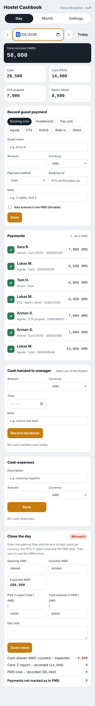
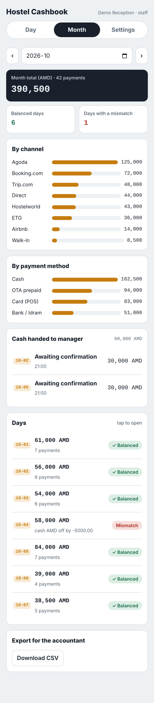
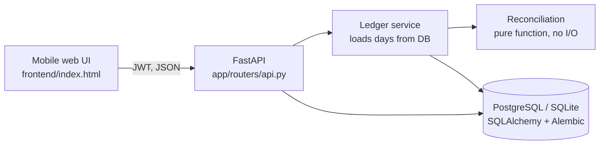

# Hostel Cashbook

[](https://github.com/MrnzMruf/hostel-cashbook/actions/workflows/ci.yml)

A daily income log and reconciliation tool for a small hostel that takes bookings from many channels (Booking.com, Hostelworld, Trip.com, Agoda, ETG, Airbnb, walk-ins) and gets paid in several ways (cash in several currencies, card, OTA-prepaid, bank transfer).

At the end of every day it compares three independent sources and shows exactly where any difference is:

| Check | Compares | Catches |
|---|---|---|
| **Cash drawer** (per currency) | counted cash vs. opening + cash in − handovers − expenses | missing cash, unrecorded handovers, wrong change |
| **Card** | POS Z-report vs. card payments recorded | missed or double card entries |
| **PMS** | total entered in the PMS / Airtable vs. everything recorded | bookings never entered in the PMS |

## The problem

Reception enters bookings into a PMS (Airtable) and cash goes into a drawer, from which the manager periodically takes cash. At month end the books didn't match and there was no way to tell **which day** or **which source** caused the gap. Typical causes:

- OTA-prepaid bookings mixed up with cash payments
- cash taken by the manager that nobody wrote down
- foreign-currency payments converted at the wrong rate
- a booking paid at the desk but never entered in the PMS

This app turns a vague monthly discrepancy into a specific line on a specific day.

## Features

- **Payments** by channel, method and currency. The exchange rate is captured at entry time, so updating a rate never rewrites past days.
- **Cash handovers to the manager**, with a two-step flow: reception records the handover, the manager confirms receipt. Confirmed handovers can't be deleted by staff.
- **Cash expenses** paid from the drawer.
- **Close the day**: per-currency opening float and count (the opening float is suggested from the previous day's count), POS Z-report total, PMS total.
- **Per-entry PMS checkbox**, so you can see which payments still need entering.
- **Monthly report**: totals by channel and method, all handovers, each day's status and issues.
- **CSV export** for the accountant.
- **Roles**: `staff` (reception) and `manager` (confirms handovers, manages exchange rates).
- Mobile-first web UI served by the API, light and dark theme.

## Screenshots

Demo data only.

| Day view | Month view |
|---|---|
|  |  |

## Architecture



The reconciliation logic (`app/services/reconcile.py`) is a pure function over plain dataclasses, so the accounting rules are tested without a database or HTTP.

Money is stored as `NUMERIC(12,2)` and handled as `Decimal` end to end; floats only appear in the JSON response.

```
app/
  config.py            settings from env (.env)
  db.py                engine and session
  models.py            tables: users, rates, entries, handovers, expenses, day_closes, cash_counts
  schemas.py           request/response models and validation
  auth.py              JWT + scrypt password hashing, role guard
  routers/api.py       REST endpoints
  services/ledger.py   DB loading, rate conversion, opening-float suggestion
  services/reconcile.py  the accounting rules
  cli.py               create users, seed demo data
alembic/               migrations
frontend/index.html    single-file UI
tests/                 unit tests for the rules + API tests
```

## Run it

### With Docker (PostgreSQL)

```bash
cp .env.example .env          # set JWT_SECRET and POSTGRES_PASSWORD
docker compose up --build
docker compose exec api python -m app.cli create-user mery --role staff
docker compose exec api python -m app.cli create-user owner --role manager
```

Open http://localhost:8000 for the app, http://localhost:8000/docs for the interactive API docs.

### Locally (SQLite)

```bash
python -m venv .venv && source .venv/bin/activate
pip install -r requirements-dev.txt
alembic upgrade head
python -m app.cli seed-demo   # demo/demo (staff), manager/manager
uvicorn app.main:app --reload
```

### Tests

```bash
pytest -q
```

## API

| Method | Path | Who |
|---|---|---|
| `POST` | `/api/auth/token` | anyone (OAuth2 password form) |
| `GET` | `/api/auth/me`, `/api/meta` | signed in |
| `GET` | `/api/days/{date}` | signed in. Day with entries, handovers, expenses, reconciliation and suggested opening float |
| `PUT` | `/api/days/{date}/close` | signed in. Opening/count per currency, Z-report, PMS total |
| `POST` `PATCH` `DELETE` | `/api/entries[/{id}]` | signed in |
| `POST` `DELETE` | `/api/handovers[/{id}]` | signed in. Confirmed handovers: manager only |
| `POST` | `/api/handovers/{id}/confirm` | manager |
| `POST` `DELETE` | `/api/expenses[/{id}]` | signed in |
| `GET` `PUT` | `/api/rates` | read: signed in, write: manager |
| `GET` | `/api/reports/monthly?month=YYYY-MM` | signed in |
| `GET` | `/api/reports/monthly.csv?month=YYYY-MM` | signed in |

Channels, currencies, base currency and the rounding tolerance are settings (`app/config.py`), not code.

## Roadmap

- Lock a day once it is balanced, with a manager-only unlock and an audit log
- Import the PMS export (CSV) and match entries by guest name + check-in date instead of typing the PMS total
- OTA payout tracking: mark prepaid bookings as paid out when the money arrives

## License

MIT
